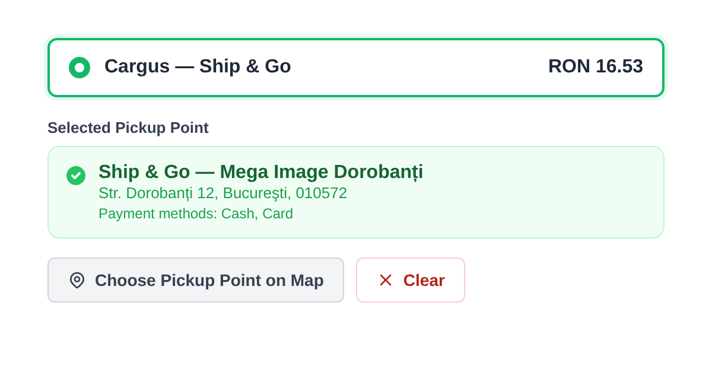
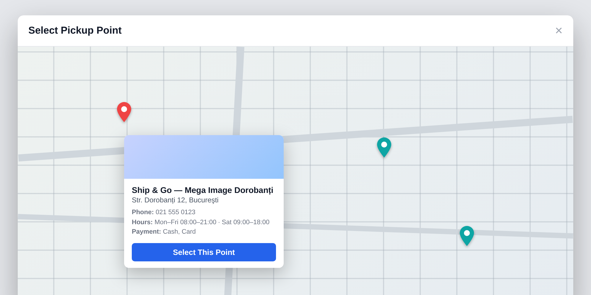
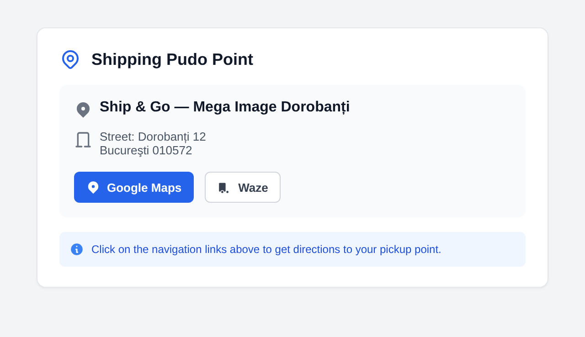

# Urgent Cargus — Hyvä Checkout

Brings **Urgent Cargus Ship & Go** pickup-point selection to the [Hyvä Checkout](https://www.hyva.io/hyva-checkout.html). When a shopper picks a Cargus **Ship & Go** shipping method, they choose a **PUDO point** (a pickup point or locker) on an interactive map; the choice is validated, saved to the order, and shown — with directions — on the order page.

This is the Hyvä-Checkout compatibility layer for the base **Urgent CargusShipGo** shipping module; it reuses that module's pickup-point data and map, re-implemented for Hyvä's Magewire architecture.

## In checkout

Selecting a Cargus Ship & Go method reveals a pickup-point selector. Once a point is chosen it's shown as a summary card, and can be changed or cleared.

*The selector after a point is chosen — the picked point with its payment options, and buttons to reopen the map or clear the choice.*

## Choosing a point on the map

**Choose Pickup Point on Map** opens a modal with an interactive map (Leaflet + OpenStreetMap) of the nearby Cargus points. Each pin's popup shows the point's name, address, phone, opening hours and accepted payment methods, with a **Select This Point** action.

*Representative view of the map modal — pins for nearby points and a popup with the point's details.*

To keep it fast, the map centres on the customer's address and shows the **nearby** points rather than all ~1,900 at once.

## On the order

After purchase, the chosen pickup point is shown on the order (and in the account) with its address and **Google Maps / Waze** directions links.

*Representative view of the order-page pickup-point block — generated for the documentation.*

## Behaviour & requirements

- **Validation** — a pickup point must be selected before a Cargus Ship & Go order can be placed.
- **No configuration of its own** — it detects Cargus Ship & Go methods (`cargus_shipandgo*`) and reuses the base module's settings and pickup-point data.
- **Requires:** the base **Urgent CargusShipGo** module (configured with your Cargus API credentials), **Hyvä Checkout**, and **Magewire**. PHP 8.1+.
